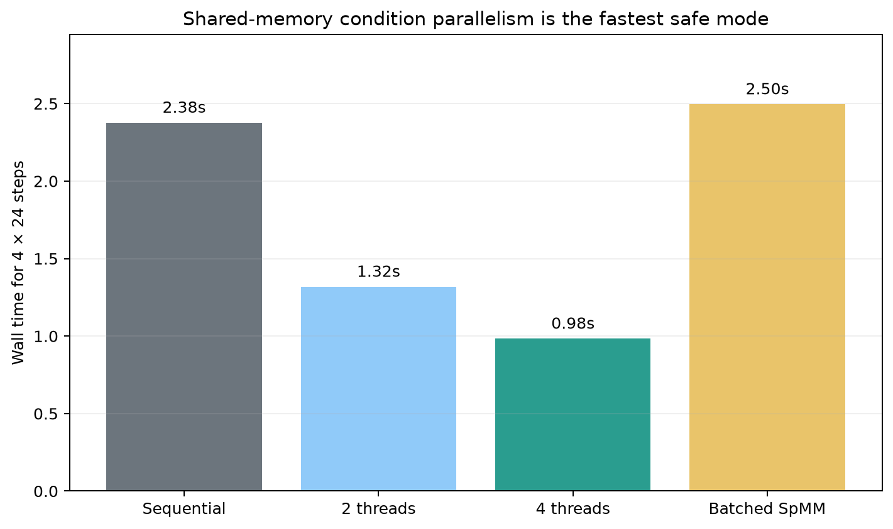

# Phase 3.5 performance profile and optimization

## Hardware and baseline

- CPU: AMD Ryzen 7 7445HS with Radeon 740M Graphics, 6 physical / 12 logical cores.
- RAM: 16,357,146,624 bytes total; 2,506,432,512 bytes available at profile start.
- Sparse matrix storage: 158,746,888 bytes.
- Baseline for four independent 24-step conditions: 2.3769 s wall time, 40.39 neural steps/s, 2.3125 CPU seconds, approximately 97.3% of one core.
- Peak RSS during the profile: 574,922,752 bytes (548.29 MiB).

Component timing for one 24-step condition was 0.5260 s. Sparse matrix-vector multiplication consumed 0.5195 s, or 98.77%. Copy, decay, presynaptic preparation, external input addition, threshold/reset, and metric collection together consumed about 1.23%. Encoding and readout indexing are therefore not the useful optimization target at this scale.

NumPy reports an OpenBLAS build capable of 24 threads, but the sparse matrix-vector workload behaved as essentially single-core. No NVIDIA runtime was found, and CuPy, PyTorch, PyOpenCL, and ONNX Runtime were absent. The integrated Radeon GPU alone does not establish a useful sparse-compute path, so no GPU stack was installed.

## Tested execution strategies

| Strategy | Wall time | Speedup | Output equivalence |
|---|---:|---:|---|
| Sequential | 2.3769 s | 1.000x | Reference |
| 2 shared-memory threads | 1.3183 s | 1.803x | Exact |
| 4 shared-memory threads | 0.9831 s | 2.418x | Exact |
| Batched sparse-matrix/matrix | 2.4959 s | 0.952x | Exact |

The four-thread run used 3.5 CPU seconds over 0.9831 wall seconds, equivalent to about 3.56 busy cores or 29.7% of the 12 logical-core total. It shares one immutable CSR graph and therefore avoids multiplying the roughly 151 MiB graph across worker processes. The batched implementation remains available for testing, but it was slower on this hardware and is not the selected execution mode.

## Decision

Independent conditions are run with four threads. More workers were not pursued because available RAM was already low and the measured 2.42x speedup was sufficient for the bounded investigation. No system-wide settings were changed. Numerical equivalence tests and the full regression suite passed.

Machine-readable evidence is in `experiments/phase35/results/performance_profile.json`.

