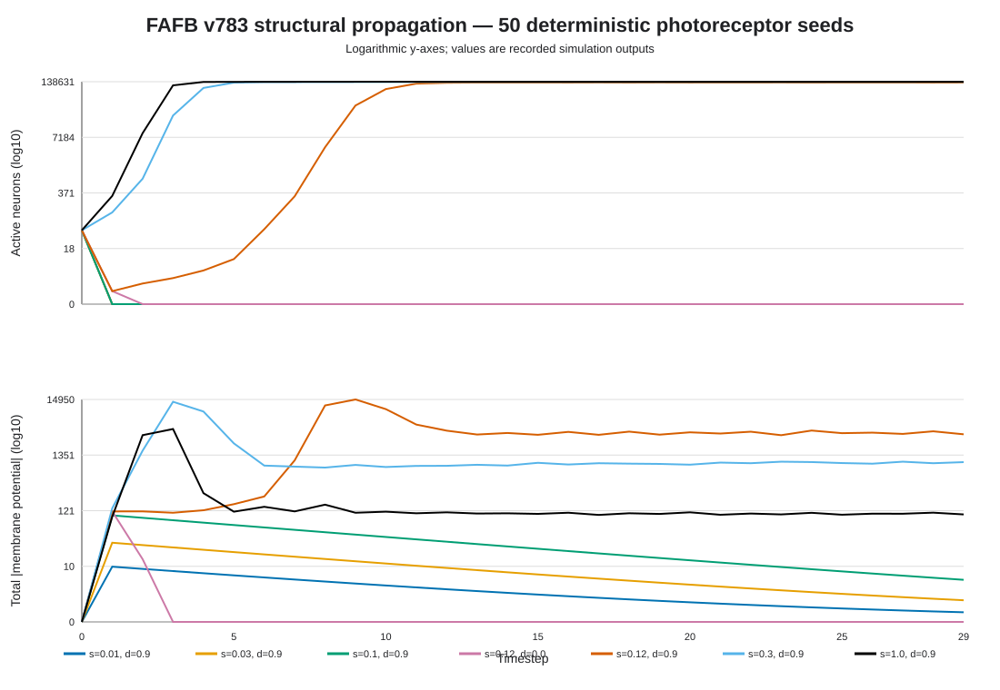

# FlyCraft Phase 2 Report

## Result

We built a simplified computational neural model using the structural connectivity of the FAFB fruit-fly connectome and demonstrated signal propagation through it. This is not a recreation of biological fly physiology, cognition, or consciousness.

## Simulator architecture

- Deterministic dense index: all metadata `root_id` values sorted ascending.
- Population: all 139,255 metadata neurons; graph-absent neurons are explicit isolated nodes.
- Sparse graph: SciPy CSR, rows=postsynaptic neurons and columns=presynaptic neurons.
- The 22,285,323 neuropil-separated records were aggregated by directed pre/post pair using summed `syn_count`.
- Processed edges: **19,773,733**; total raw weight: **76,944,499**.
- Default transmitter treatment: unsigned. Unknown/blank transmitter values use explicit positive gain +1; no connection is silently dropped.
- Weight transforms implemented: raw, square root, log1p, clipped, and normalized/clipped.

## Neuron update

For synchronous timestep `t`, `V[t+1] = decay × V[t] + W × spikes[t] + external_current[t]`. Neurons spike where `V >= threshold`, then reset to `reset_value`. This is a dimensionless leaky-integrate-and-fire-like engineering abstraction.

## Stimulation

- Random seed recorded: 783 (selection itself is deterministic and uses no randomness).
- Candidate annotation: exact visual `family == Photo Receptors`.
- Selection rule: first 50 ascending root IDs that have at least one graph edge.
- External current: 1.05 for timestep 0 only.
- Timesteps per configuration: 30.
- A five-step zero-input baseline was silent for every configuration.

## Stability experiments

| Weight transform | Scale | Threshold | Decay | Peak active | Peak newly active | Unique active | Last active step | Runaway ≥25% | Saturated tail | ms/step | steps/s | CPU (one-core basis) | Peak RSS |
| --- | ---: | ---: | ---: | ---: | ---: | ---: | ---: | --- | --- | ---: | ---: | ---: | ---: |
| log1p | 0.01 | 1.0 | 0.9 | 50 | 50 | 50 | 0 | False | False | 17.786 | 56.22 | 96.6% | 373.39 MiB |
| log1p | 0.03 | 1.0 | 0.9 | 50 | 50 | 50 | 0 | False | False | 16.355 | 61.14 | 98.7% | 373.45 MiB |
| log1p | 0.1 | 1.0 | 0.9 | 50 | 50 | 50 | 0 | False | False | 16.085 | 62.17 | 100.4% | 373.46 MiB |
| log1p | 0.12 | 1.0 | 0.0 | 50 | 50 | 51 | 1 | False | False | 16.405 | 60.96 | 98.4% | 373.46 MiB |
| log1p | 0.12 | 1.0 | 0.9 | 132,489 | 54,647 | 136,948 | 29 | True | True | 16.381 | 61.05 | 101.7% | 373.46 MiB |
| log1p | 0.3 | 1.0 | 0.9 | 136,694 | 76,505 | 137,919 | 29 | True | True | 17.597 | 56.83 | 100.6% | 373.46 MiB |
| log1p | 1.0 | 1.0 | 0.9 | 138,631 | 105,320 | 138,792 | 29 | True | True | 16.256 | 61.52 | 99.3% | 373.45 MiB |

Exact active-neuron counts by timestep:

| Scale | Decay | Counts for timesteps 0–29 |
| ---: | ---: | --- |
| 0.01 | 0.9 | 50, 0, 0, 0, 0, 0, 0, 0, 0, 0, 0, 0, 0, 0, 0, 0, 0, 0, 0, 0, 0, 0, 0, 0, 0, 0, 0, 0, 0, 0 |
| 0.03 | 0.9 | 50, 0, 0, 0, 0, 0, 0, 0, 0, 0, 0, 0, 0, 0, 0, 0, 0, 0, 0, 0, 0, 0, 0, 0, 0, 0, 0, 0, 0, 0 |
| 0.1 | 0.9 | 50, 0, 0, 0, 0, 0, 0, 0, 0, 0, 0, 0, 0, 0, 0, 0, 0, 0, 0, 0, 0, 0, 0, 0, 0, 0, 0, 0, 0, 0 |
| 0.12 | 0.0 | 50, 1, 0, 0, 0, 0, 0, 0, 0, 0, 0, 0, 0, 0, 0, 0, 0, 0, 0, 0, 0, 0, 0, 0, 0, 0, 0, 0, 0, 0 |
| 0.12 | 0.9 | 50, 1, 2, 3, 5, 10, 53, 310, 4239, 39073, 93716, 125191, 130769, 132222, 131884, 132272, 131778, 132385, 131727, 132396, 131825, 132184, 131884, 132489, 131526, 132314, 132024, 132233, 131805, 132411 |
| 0.3 | 0.9 | 50, 131, 793, 22936, 99436, 132245, 135955, 136165, 136302, 136271, 136450, 136428, 136493, 136477, 136532, 136473, 136613, 136533, 136596, 136602, 136644, 136562, 136650, 136577, 136645, 136654, 136663, 136578, 136694, 136603 |
| 1.0 | 0.9 | 50, 316, 8975, 114287, 136808, 137424, 137692, 137967, 138191, 138414, 138500, 138563, 138586, 138600, 138611, 138615, 138616, 138628, 138623, 138623, 138622, 138631, 138627, 138626, 138623, 138629, 138626, 138623, 138624, 138629 |

## Memory and initialization

- Saved compressed CSR file: 61.42 MiB.
- Raw CSR arrays in memory: 151.39 MiB.
- Graph preprocessing peak process RSS: 516.39 MiB.
- Graph preprocessing time: 101.696 seconds.
- Scale 0.01: transformed CSR 151.39 MiB, state arrays 1.46 MiB, initialization 0.111 s.
- Scale 0.03: transformed CSR 151.39 MiB, state arrays 1.46 MiB, initialization 0.110 s.
- Scale 0.1: transformed CSR 151.39 MiB, state arrays 1.46 MiB, initialization 0.109 s.
- Scale 0.12: transformed CSR 151.39 MiB, state arrays 1.46 MiB, initialization 0.109 s.
- Scale 0.12: transformed CSR 151.39 MiB, state arrays 1.46 MiB, initialization 0.107 s.
- Scale 0.3: transformed CSR 151.39 MiB, state arrays 1.46 MiB, initialization 0.115 s.
- Scale 1.0: transformed CSR 151.39 MiB, state arrays 1.46 MiB, initialization 0.131 s.

## Visualization

The plot is generated from the recorded simulation metrics; it is not decorative or fabricated brain imagery.

## Scientific assumptions and limitations

- Structural synapse counts are not calibrated voltages or conductances.
- Aggregating across neuropils discards where each synapse occurs, while preserving the total directed-pair count.
- Unsigned propagation intentionally ignores receptor-specific sign. It is a structural propagation baseline, not a claim that all fly synapses excite.
- The synchronous timestep, uniform decay/threshold/reset, one-step delay, and deterministic external current are engineering choices.
- The unthresholded export contains one-synapse records that may include false positives; no biological-confidence filter was imposed in this lossless first build.
- Cell Types and Classification exports were downloaded after the Phase 2 run.
  They have been integrity-checked but were not retroactively integrated into this
  completed experiment, so descending/output neurons are still not identified by
  the Phase 2 results.
- The available files do not explain why 139 metadata neurons have no graph representation.

## Reproducibility

- Python 3.14.7; NumPy 2.5.3; SciPy 1.18.1; Matplotlib 3.11.2; psutil 7.2.2.
- Full configuration and all timestep metrics: `experiments/phase2/phase2_metrics.json`.
- Processed graph build metadata includes source sizes and SHA-256 digests: `data/processed/build_metadata.json`.
- Data semantics and official references: `docs/data_semantics.md`.

## Failures encountered

- The first three tested scales (0.01, 0.03, 0.10) produced only the externally driven timestep-0 spikes; this non-propagation result is retained.
- Matplotlib's raster backend was blocked by Windows Application Control after the first simulation run. The plot was reimplemented as dependency-free SVG and the complete experiment rerun.
Successful results above are from commands that completed against the real processed graph.

## Phase boundary

Phase 2 is complete. Work stops here pending explicit approval for Phase 3.

No Minecraft, 2D agent, learning, training, movement decoding, tutorial system, or Fabric work was started.
