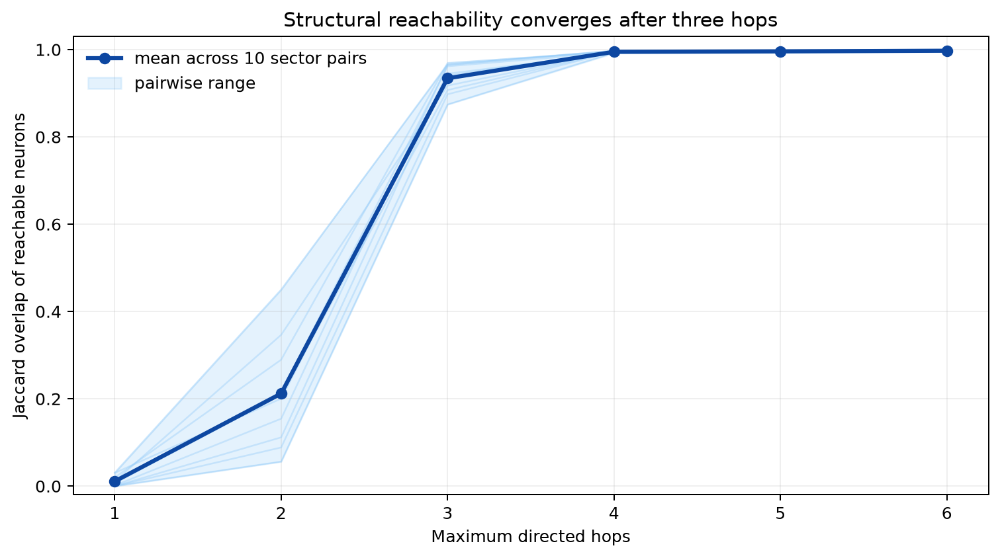

# Phase 3.5 structural path analysis

## Scope and method

This analysis uses the preserved 139,255-neuron, 19,773,733-edge directed CSR graph. For each deterministic 50-photoreceptor sector cohort, an exact multi-source directed breadth-first search was performed with sparse Boolean frontiers. This finds shortest hop counts without attempting impractical exhaustive path enumeration. Machine-readable results are in `experiments/phase35/results/path_analysis.json`.

## Data facts

- Every cohort reaches all 1,305 explicitly classified descending neurons. The shortest descending paths are 2 hops; most are 3 hops. The longest shortest path is 5 hops for one far-left case and 4 hops otherwise.
- Every cohort reaches all 7,684 neurons whose classification `super_class` is `visual_projection`. Sixteen to 33 of those cells are one hop away, 1,828 to 2,639 are two hops away, and most remaining cells are three hops away.
- Each cohort reaches 138,794 to 138,802 of all 139,255 graph neurons.
- The selected cohorts are not unusually disconnected. Their median outgoing degree is 7 to 9, compared with 8 across all supported photoreceptors. Their median outgoing synapse count is 117 to 161.5, compared with 144 for all supported photoreceptors.
- Different sector reachability expands rapidly into the same graph. Mean pairwise Jaccard overlap is 0.0109 through one hop, 0.2121 through two hops, 0.9343 through three hops, and 0.9949 through four hops. All sector pairs can reach exactly the same descending set (Jaccard 1.0).

## Biological interpretation

The selected sensory cells are structurally capable of influencing descending cells, and the required graph distance is not extreme. However, reachability is not evidence that a signal will propagate under a particular dynamical model. The very strong convergence by three hops provides a plausible structural reason that an unsigned, homogeneous propagation rule loses sector identity or becomes globally active.

The `visual_projection` group is an annotation-backed intermediate visual-output population. It is closer to the photoreceptor cohorts and is therefore a defensible place to test whether the simplified dynamics preserve sensory differences before global convergence.

## Engineering implications

The Phase 3 failure is not explained by missing directed paths or exceptionally weakly connected input cohorts. Model dynamics and normalization are the next bounded intervention. Descending readout remains the preferred endpoint, but `visual_projection` is used as an explicitly labeled engineering readout only if it passes quantitative stability and discrimination criteria.

