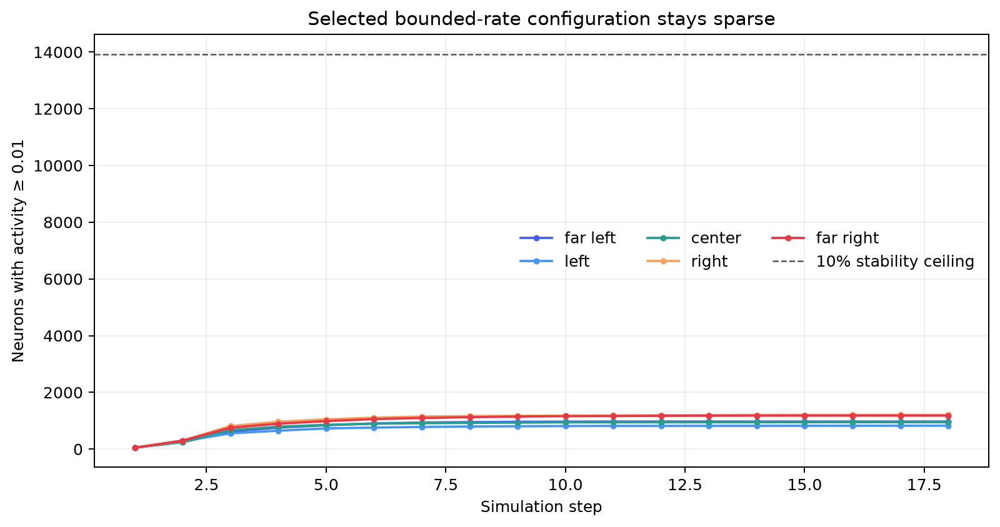
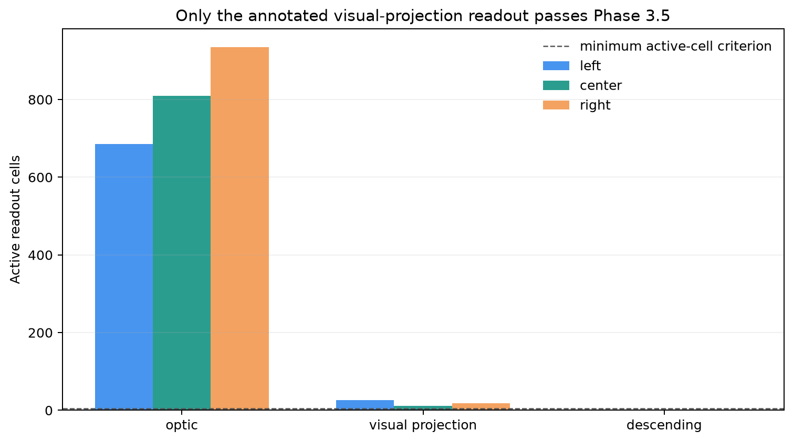

# Phase 3.5 report: neural bottleneck investigation

## Gate decision

**PASS, with an intermediate readout limitation.** A bounded-rate model produces stable, exactly repeatable, sector-dependent activity in the annotation-backed `visual_projection` population. It does not produce meaningful descending-neuron activity. Phase 4 may proceed only with that limitation visible.

## Data facts, interpretation, and choices

- **Data fact:** directed paths from every 50-cell input cohort reach all 1,305 descending cells, mostly in three hops. All cohorts also reach all 7,684 visual-projection cells.
- **Biological interpretation:** the structural graph strongly converges by three to four hops, which can help explain why a homogeneous unsigned dynamical rule transitions sharply from local silence to broad activation. This is a hypothesis supported by the path statistics, not a demonstrated physiological mechanism.
- **Engineering choice:** retain only connections with `syn_count >= 5`, divide each retained incoming row by its total incoming synapse count, multiply by gain 0.8, and apply a nonnegative saturating update `x/(1+x)`. This homeostatic-style normalization is a numerical stabilizer; it is not claimed to be the fly's actual synaptic rule.

## Bounded model investigation

Twenty-two predetermined configurations were run: 16 LIF settings across two edge thresholds, four scales, and two decay values; and six bounded-rate settings across three gains and two decay values. Each used five visible sectors plus a zero-input control for 18 steps. The gate was defined before selection:

- activity must spread beyond the 50 stimulated cells;
- global activity must stay below 10% of neurons;
- the zero-input control must remain silent;
- left, center, and right must each activate at least five readout cells;
- minimum pairwise cosine distance between their integrated readout vectors must be at least 0.10;
- an exact repeated run must match.

The LIF family retained the Phase 3 silence-to-runaway behavior. A stable LIF case (`minimum_synapses=2`, scale 0.08, decay 0.5) activated only 4/11/3 optic cells, 1/0/0 visual-projection cells, and no descending cells. Stronger settings recruited tens of thousands to more than 100,000 cells.

The selected bounded-rate setting uses `minimum_synapses=5`, gain 0.8, and decay 0.0 over 3,732,460 retained edges. Peak active counts were 825 to 1,207 of 139,255 for visible conditions and zero for the no-input control. Visual-projection active-cell counts for left/center/right were 26/12/18. Pairwise cosine distances were 0.8696, 0.9763, and 0.7985, so the minimum exceeded the 0.10 criterion by nearly eightfold. An exact repeat matched bit-for-bit.

Descending integrated activity was nonzero but tiny (0.46 to 0.69 total depending on visible condition), with zero descending cells crossing the explicit 0.01 activity threshold. It is not counted as meaningful output discrimination.

## Transmitter sign limitation

The available transmitter predictions do not include postsynaptic receptor identity. The connectome literature explicitly treats connection sign as depending on released transmitter and receptor context, and transmitter predictions have imperfect accuracy. Therefore this phase did not impose the unsupported shortcut `ACh=positive, GABA/Glutamate=negative`. The unsigned Phase 2 simulator remains intact as the baseline. Relevant sources: [Eckstein et al., Cell 2024](https://pmc.ncbi.nlm.nih.gov/articles/PMC11106717/) and the whole-brain modeling reference [Shiu et al., Nature 2024](https://doi.org/10.1038/s41586-024-07763-9).

## Likely cause of the bottleneck

The evidence rules out absent paths and unusually disconnected input cohorts. The leading explanation is the combination of high branching/convergence, raw synapse-count scaling, and uniform unsigned excitatory recurrence. Weak scaling cannot traverse the effective network; slightly stronger scaling crosses a recurrent gain boundary and recruits most of the graph. Incoming normalization plus bounded activation removes that global positive-feedback instability while preserving an early/intermediate sector signature.

## Performance and reproducibility

Four shared-memory threads reduced the four-condition benchmark from 2.3769 s to 0.9831 s (2.418x) with exact output equivalence. Peak profiled RSS was 548.29 MiB; peak RSS for the 22-configuration investigation was 641.89 MiB. Sixteen Python tests pass after the new batch, bounded-rate, population-selection, and continuous-decoder tests.

Raw results: `experiments/phase35/results/path_analysis.json`, `performance_profile.json`, `model_investigation.json`, and `rate_decoder_evaluation.json`.

## Scientific limitation

This phase establishes a stable engineering signal, not a biologically validated whole-brain simulation. It does not show useful descending control, receptor-aware signs, realistic temporal constants, or learning. The defensible claim is: a fixed connectome-derived graph with documented normalization preserves reproducible sector information at an annotated visual-projection population.

